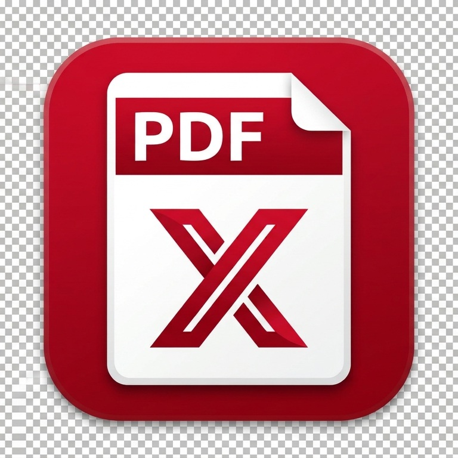

# PDF-X — Offline PDF Converter and OCR Toolbox

[](https://github.com/BorneanWingz/PDF-X)
[]()
[](LICENSE.md)
[]()

## About

PDF-X is a portable Windows application for converting, combining, organising
and editing PDF files. It can also read text from scanned pages and create
searchable PDFs.

- Copy the application folder and double-click `PDF-X.exe`; no installer or
  administrator rights are needed.
- Files stay on your computer and the application works offline by default.
- Every result is written to a new file, so the original is not overwritten.
- Settings are saved in `config.json` beside the application.
- The interface uses a left-hand menu, recent files, drag-and-drop file areas
  and consistent output controls.

## Features

### Convert File

Convert supported documents, images, text files and PDFs into another format.
The **Pages** field accepts page numbers and ranges such as `1-3,5`, or can be
left empty to use every page. Image and scan-reading quality controls are under
**Advanced Options**.

Results can be saved beside the original with **Output in same folder**, or in a
folder selected with **Browse**. These choices and the quality settings are
remembered for the next run.

### Merge PDF

Convert supported files to PDF and join them in the order shown. Files are
numbered `1.`, `2.`, and so on. Reorder them with **Move Up**, **Move Down**,
dragging, or by adding them in the desired order. At least two files are needed.

### Organise PDF

Create a new copy of a PDF with pages moved, rotated, deleted, split or
extracted. **Split every N pages** creates separate files, while **Extract a page
range** keeps only the requested pages.

### Edit PDF

- Change selectable lines of text or add a new text box anywhere on a page.
- Choose a font and size, and move or resize added text boxes.
- Use **Undo**, **Redo**, **Zoom** and page navigation while editing.
- **Apply Changes** saves page changes and text changes together as one new PDF.
- **Redact Line** removes the selected text and places a black bar over it.

For scanned documents, first create a searchable PDF on **Convert File**. The
visual editor works with upright pages and edits text line by line rather than
rearranging whole paragraphs.

### Utilities

Add watermarks or page numbers, find and replace words, and compress PDFs.
Utilities, Edit PDF and Organise PDF share the same opened document.

**Compress PDF** can:

- Repack page content to remove unnecessary repetition.
- Share duplicate fonts, images and other page resources.
- Re-encode images as JPEG using a quality from 10 to 95.
- Optionally reduce images to 72, 96, 150, 200 or 300 DPI.
- Optionally convert images to grayscale.
- Keep the original image when the compressed replacement would be larger.

Compression writes a new file with the `_compressed` suffix and never changes the
source PDF. An automated test confirms that a suitable image-heavy PDF becomes
smaller and remains readable.

### About

The About screen shows the version and author information. The author is
**Dr. Longwin Sii**.

## Supported conversions

| Source | Target |
| --- | --- |
| PDF | PNG, JPG, TIF, TXT, HTML, XLSX tables, PPTX, DOCX |
| Scanned PDF | Searchable PDF, TXT, HTML, XLSX, PPTX, DOCX |
| Any supported files | One merged PDF |
| PDF in Organise or Edit | Reordered, rotated, deleted, split, extracted, watermarked, numbered or edited PDF |
| PNG, JPG, TIF, BMP, WebP | PDF |
| TXT, MD | PDF |
| DOC, DOCX, XLS, XLSX, PPT, PPTX, ODT, ODS, ODP, RTF, CSV | PDF using the bundled LibreOffice converter |

The optional PDF-to-Word converter is kept in `plugins/`. It may be omitted from
clean builds.

## Installation and use

PDF-X is distributed as a portable folder. Copy the folder to a location you can
access, then open `PDF-X.exe`.

The command-line helper is `PDF-X-CLI.exe`. For example:

```text
PDF-X-CLI.exe report.pdf --to png --dpi 200
```

It can also list available conversion targets and check the status of the
converters, optional plugins and scan-reading models.

## Updates

**Current version: 0.1.7**

### Version 0.1.7

- Utilities became its own screen for watermarks, page numbers, find-and-replace
  and compression.
- Edit PDF became a direct editor with compact previous and next page buttons.
- The page preview stays centred when the window is resized.
- Processing Log controls were removed from the screens to leave more room for
  the work area.
- About now links to the README and identifies the author.
- Windows program information is filled in during packaging.

## How it works

### Normal documents

PDF-X reads the document, performs the selected conversion or edit, and writes a
new result beside the original or in the folder you choose.

### Scanned documents

The app reads the words in a scanned page, and it can add an invisible text
layer so the result can be searched and copied.

### Portable design

The finished application is a folder containing the main program, command-line
helper, settings file, optional converters, the bundled Office converter and the
scan-reading models. It does not need a system-wide installation.

## Credits

PDF-X uses the following open-source projects and components:

- pypdfium2 / PDFium for rendering PDF pages.
- pypdf for PDF text, page handling, merging and writing.
- pdfplumber and openpyxl for table extraction and Excel output.
- python-pptx for PowerPoint output.
- Pillow for image handling and image-to-PDF conversion.
- ReportLab for PDF creation and searchable PDF writing.
- RapidOCR for offline scan reading.
- LibreOffice for bundled Office-to-PDF conversion.

## Preview

The application artwork are stored in the repository assets:



The application includes screens for converting files, merging PDFs, organising
pages, editing PDF text and applying utilities such as compression and
watermarks.

## License

PDF-X is released under the MIT License. See [LICENSE.md](LICENSE.md) for the
full licence and the component licensing map.

---

*PDF-X · Version 0.1.7 · Author: Dr. Longwin Sii*
