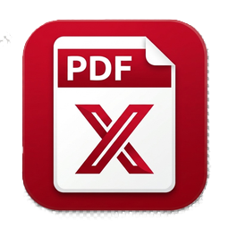
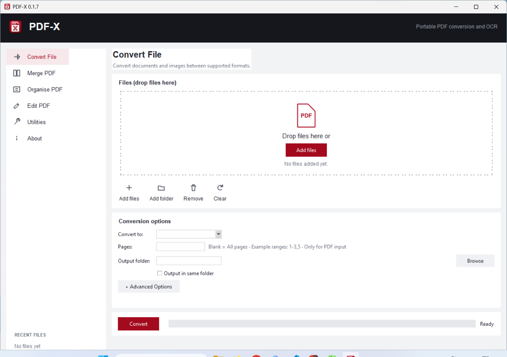

# PDF-X — Offline PDF Converter and OCR Toolbox

[](https://github.com/BorneanWingz/PDF-X/blob/main/Build%20Release%20Notes.md)
[]()
[](LICENSE.md)
[]()

<div align="center">
    
    <h1>📄 PDF-X</h1>
    <h3><em>Convert, organise and edit PDFs offline.</em></h3>
</div>

## About

PDF-X is a portable Windows application for converting, combining, organising
and editing PDF files. It can also read text from scanned pages and create
searchable PDFs.

- Copy the application folder and double-click `PDF-X.exe`; no installer or
  administrator rights are needed.
- Files stay on your computer and the application works offline by default.
- Every result is written to a new file, so the original is not overwritten.
- Settings are saved in `config.json` beside the application.
- The interface uses a left-hand menu, recent files, drag-and-drop file areas
  and consistent output controls.

## Features

### Convert File

Convert supported documents, images, text files and PDFs into another format.
The **Pages** field accepts page numbers and ranges such as `1-3,5`, or can be
left empty to use every page. Image and scan-reading quality controls are under
**Advanced Options**.

Office documents can also be converted directly to the modern format in their
family: Word/Writer formats to DOCX, spreadsheets to XLSX, and presentations to
PPTX. Other conversions continue to use PDF as the hub.

Results can be saved beside the original with **Output in same folder**, or in a
folder selected with **Browse**. These choices and the quality settings are
remembered for the next run.

When enabled, PDF-X checks the hosted `promo.json` on startup over HTTPS. A
newer release appears as an optional clickable banner; versions below
`minimum_version` are required to update. In that case, PDF-X displays the
download URL, opens it in the default browser automatically, then closes. The
build script updates the manifest version and keeps the immediately previous
release as the minimum, so a new release can make versions two releases old
obsolete. Push the updated manifest and publish the matching release for users
to receive it. Set `promo.enabled` to `false` in the user config to disable the
network check.

When converting a scanned PDF to DOCX, XLSX or PPTX, PDF-X reminds you to first
create a **SEARCHABLE-PDF** copy. You can inspect the OCR text in that copy
before converting it to an Office format.

### Merge PDF

Convert supported files to PDF and join them in the order shown. Files are
numbered `1.`, `2.`, and so on. Reorder them with **Move Up**, **Move Down**,
dragging, or by adding them in the desired order. At least two files are needed.

### Organise PDF

Create a new copy of a PDF with pages moved, rotated, deleted, split or
extracted. **Split every N pages** creates separate files, while **Extract a page
range** keeps only the requested pages.

### Edit PDF

- Import a PDF or drag and drop one onto the empty editor or page preview.
- Use **Open a new window** beside the document name for a maximized editor;
  closing it returns the same editing session to the tab.
- Change selectable lines of text or add a new text box anywhere on a page.
- Select **Queue Change** to include a line correction when saving. Click a
  blank area to deselect a line; queue its correction first.
- Choose a font and size, and move or resize added text boxes.
- Click outside a text box to finish editing it; **Apply Changes** saves it.
- Text wraps to the box width; text taller than the box extends below it in the
  saved PDF, so check the page before sharing.
- Use **Undo**, **Redo**, **Zoom** and page navigation while editing.
- **Apply Changes** saves page changes and text changes together as one new PDF.
- **Redact Line** burns a black mask into the selected area of each affected
  page, then rebuilds that page and OCRs the remaining visible text.

Line corrections are visual overlays: the original text remains searchable
underneath. Redacted pages are rasterized, so their original vector content and
annotations are flattened; OCR may not reproduce every unredacted word exactly.
Inspect the output carefully before sharing it.

For scanned documents, first create a searchable PDF on **Convert File**. The
visual editor works with upright pages and edits text line by line rather than
rearranging whole paragraphs. Undo and Redo apply to text edits and boxes, not
page changes made on Organise PDF.

### Utilities

Add watermarks or page numbers, find and replace words, and compress PDFs.
Utilities, Edit PDF and Organise PDF share the same opened document.

**Compress PDF** can:

- Repack page content to remove unnecessary repetition.
- Share duplicate fonts, images and other page resources.
- Re-encode images as JPEG using a quality from 10 to 95.
- Optionally reduce images to 72, 96, 150, 200 or 300 DPI.
- Optionally convert images to grayscale.
- Keep the original image when the compressed replacement would be larger.

Compression writes a new file with the `_compressed` suffix and never changes the
source PDF. An automated test confirms that a suitable image-heavy PDF becomes
smaller and remains readable.

### About

The About screen shows the version and author information. The author is
**Dr. Longwin Sii**.

## Supported conversions

| Source | Target |
| --- | --- |
| PDF | PNG, JPG, TIF, TXT, HTML, XLSX tables, PPTX, DOCX |
| Scanned PDF | Searchable PDF, TXT, HTML, XLSX, PPTX, DOCX |
| Word/Writer formats | DOCX |
| Spreadsheet formats | XLSX |
| Presentation formats | PPTX |
| Any supported files | One merged PDF |
| PDF in Organise or Edit | Reordered, rotated, deleted, split, extracted, watermarked, numbered or edited PDF |
| PNG, JPG, TIF, BMP, WebP | PDF |
| TXT, MD | PDF |
| DOC, DOCX, XLS, XLSX, PPT, PPTX, ODT, ODS, ODP, RTF, CSV | PDF using the bundled LibreOffice converter |

The optional PDF-to-Word converter is kept in `plugins/`. It may be omitted from
clean builds.

## Installation and use

PDF-X is distributed as a portable folder. Copy the folder to a location you can
access, then open `PDF-X.exe`.

The command-line helper is `PDF-X-CLI.exe`. For example:

```text
PDF-X-CLI.exe report.pdf --to png --dpi 200
```

It can also list available conversion targets and check the status of the
converters, optional plugins and scan-reading models.

## Updates

**Current version: 0.1.8**

### Version 0.1.8

- Added drag-and-drop loading and an optional maximized editing window.
- Fixed text-box editing, line deselection and saving redactions with text edits.
- Improved text-box wrapping, Fit zoom and editing controls.
- Redaction masks selected pixels, rebuilds affected pages and OCRs the visible
  remainder.
- Added same-family Office conversions and a reminder to OCR scanned PDFs before
  converting to Office.
- Added an optional update banner and a required-update flow that opens the
  download page before closing obsolete versions.
- Documented visual editing, redaction and update limitations.

### Version 0.1.7

- Utilities became its own screen for watermarks, page numbers, find-and-replace
  and compression.
- Edit PDF became a direct editor with compact previous and next page buttons.
- The page preview stays centred when the window is resized.
- Processing Log controls were removed from the screens to leave more room for
  the work area.
- About now links to the README and identifies the author.
- Windows program information is filled in during packaging.

## How it works

### Normal documents

PDF-X reads the document, performs the selected conversion or edit, and writes a
new result beside the original or in the folder you choose.

### Scanned documents

The app reads the words in a scanned page, and it can add an invisible text
layer so the result can be searched and copied.

### Portable design

The finished application is a folder containing the main program, command-line
helper, settings file, optional converters, the bundled Office converter and the
scan-reading models. It does not need a system-wide installation.

## Credits

PDF-X uses the following open-source projects and components:

- pypdfium2 / PDFium for rendering PDF pages.
- pypdf for PDF text, page handling, merging and writing.
- pdfplumber and openpyxl for table extraction and Excel output.
- python-pptx for PowerPoint output.
- Pillow for image handling and image-to-PDF conversion.
- ReportLab for PDF creation and searchable PDF writing.
- RapidOCR for offline scan reading.
- LibreOffice for bundled Office-to-PDF conversion.

## Preview



## License

PDF-X is released under the MIT License. See [LICENSE.md](LICENSE.md) for the
full licence and the component licensing map.

---

*PDF-X · Version 0.1.8 · Author: Dr. Longwin Sii*
